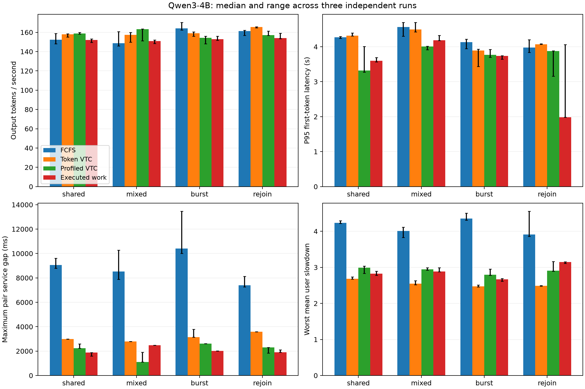
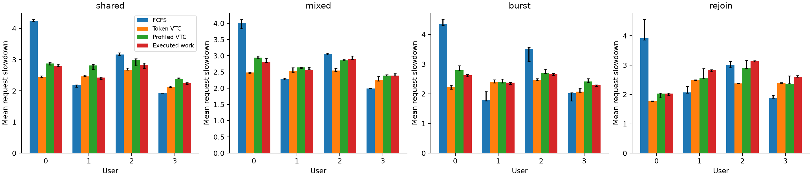

# Executed compute service in cached, chunked LLM inference

Executed-work accounting reduces independently measured service gaps by **16.16% on shared prefixes** and **22.73% on burst arrivals**, compared with profiled VTC. The corresponding median throughput changes are −4.32% and −0.79%. On mixed-length requests without shared prefixes, the same frozen policy has a **122.60% larger service gap** and **7.65% lower throughput**. Explicit cache, chunk and batch accounting provides workload-dependent fairness tradeoffs; accurate aggregate cost prediction alone does not determine a better service allocation.

The implementation extends vLLM Ascend with weighted virtual-service scheduling, executed-chunk accounting, preemption recomputation and per-batch reservations. The study uses the public Qwen3-4B checkpoint, four workloads, four policies and three independent processes per condition: **48 policy runs, 1,536 completed requests and 46,080 generated tokens**. Every executed query/context/prompt shape has a separately measured service reference.

## Policy results

Entries are median [minimum, maximum] across three independent processes. A smaller service gap, TTFT or slowdown is preferable; larger throughput is preferable. Worst mean user slowdown is the largest of the four per-user mean request slowdowns.

| Workload | Policy | Output tok/s | P95 TTFT, s | Maximum pair gap, ms | Worst mean user slowdown |
|---|---|---:|---:|---:|---:|
| shared | FCFS | 152.26 [148.22, 158.81] | 4.271 [4.241, 4.290] | 9057.1 [8796.9, 9620.3] | 4.236 [4.222, 4.291] |
| shared | Token VTC | 158.03 [155.07, 158.51] | 4.314 [4.309, 4.392] | 2990.2 [2990.2, 2990.2] | 2.680 [2.673, 2.733] |
| shared | Profiled VTC | 158.78 [158.10, 159.82] | 3.320 [3.272, 4.011] | 2237.2 [2237.2, 2599.6] | 2.989 [2.833, 3.035] |
| shared | Executed work | 151.92 [149.39, 153.28] | 3.602 [3.567, 3.694] | 1875.6 [1603.1, 1875.6] | 2.828 [2.778, 2.896] |
| mixed | FCFS | 148.80 [145.99, 160.75] | 4.564 [4.298, 4.694] | 8530.2 [7893.6, 10285.1] | 4.012 [3.832, 4.117] |
| mixed | Token VTC | 157.37 [149.79, 159.87] | 4.493 [4.427, 4.695] | 2794.7 [2794.7, 2794.7] | 2.546 [2.515, 2.632] |
| mixed | Profiled VTC | 163.27 [151.29, 163.57] | 4.009 [3.913, 4.015] | 1117.1 [1117.1, 1894.5] | 2.946 [2.923, 2.992] |
| mixed | Executed work | 150.78 [148.38, 152.13] | 4.188 [4.177, 4.322] | 2486.6 [2486.6, 2486.6] | 2.886 [2.878, 2.993] |
| burst | FCFS | 163.95 [162.52, 170.22] | 4.130 [3.948, 4.216] | 10410.0 [10018.7, 13455.8] | 4.352 [4.311, 4.505] |
| burst | Token VTC | 159.17 [155.92, 160.32] | 3.896 [3.439, 3.933] | 3150.3 [3149.6, 3779.8] | 2.470 [2.459, 2.512] |
| burst | Profiled VTC | 154.15 [148.03, 156.10] | 3.765 [3.700, 3.921] | 2615.8 [2611.7, 2616.5] | 2.794 [2.777, 2.949] |
| burst | Executed work | 152.93 [151.73, 155.87] | 3.735 [3.643, 3.744] | 2021.3 [2021.1, 2021.4] | 2.670 [2.616, 2.691] |
| rejoin | FCFS | 161.15 [156.74, 162.02] | 3.980 [3.841, 4.199] | 7399.8 [7266.9, 8136.5] | 3.914 [3.859, 4.554] |
| rejoin | Token VTC | 165.42 [164.75, 165.65] | 4.071 [4.067, 4.087] | 3583.3 [3583.3, 3583.3] | 2.489 [2.482, 2.495] |
| rejoin | Profiled VTC | 157.09 [156.94, 161.16] | 3.874 [3.160, 3.887] | 2296.4 [1839.6, 2296.4] | 2.907 [2.895, 3.160] |
| rejoin | Executed work | 154.01 [153.53, 158.95] | 1.984 [1.981, 4.059] | 1900.6 [1900.6, 2104.8] | 3.148 [3.111, 3.153] |

Shared prefixes give executed-work accounting a smaller service gap than profiled VTC in every repetition, while its throughput range is also lower. The 8.50% higher median P95 TTFT is part of this tradeoff. On burst arrivals, the service-gap ranges remain disjoint, whereas throughput and TTFT ranges overlap. These three-run ranges describe observed variability rather than confidence intervals.

Mixed-length requests produce the opposite gap ranking: executed work has a 2,486.6 ms median gap versus 1,117.1 ms for profiled VTC. Its median throughput is 150.78 versus 163.27 tok/s. The workload contains no initially cached prefix tokens; shared, burst and rejoin each contain 3,072. The full comparison retains this workload.

For rejoin, executed work has a 17.24% lower median gap and 1.96% lower median throughput than profiled VTC, with overlapping repetition ranges. Its P95 TTFT is 1.984 [1.981, 4.059] seconds, so the 48.80% median reduction does not describe every repetition. Worst mean user slowdown increases by 8.29%, from 2.907 to 3.148. User 0 actually becomes idle before returning in all twelve rejoin runs; the idle interval is 1.420–1.466 seconds.

Token VTC has the lowest worst-user mean slowdown in all four workloads. Its independent service gap is larger than executed work in every workload. The service-gap and slowdown objectives therefore select different policies. The [per-user CSV](results/formal/summary/per_user.csv) retains each user's independent service and slowdown, with all three-run ranges.

## Execution behavior and accounting ablation

The token, profiled and executed-work conditions change the accounting definition while retaining the same service-based admission and batch construction. FCFS provides the engine's arrival-order control. The following values are medians of three independent runs.

| Workload | Policy | Recomputed queries | Preemptions | Mean requests per batch |
|---|---|---:|---:|---:|
| shared | Profiled VTC | 1264 | 17 | 7.193 |
| shared | Executed work | 972 | 14 | 6.734 |
| mixed | Profiled VTC | 1250 | 19 | 7.579 |
| mixed | Executed work | 1440 | 23 | 7.109 |
| burst | Profiled VTC | 1239 | 14 | 7.029 |
| burst | Executed work | 988 | 18 | 6.896 |
| rejoin | Profiled VTC | 1288 | 16 | 7.071 |
| rejoin | Executed work | 2714 | 30 | 7.012 |

Shared-prefix executed work recomputes fewer queries than profiled VTC, but packs fewer requests into each batch. Mixed-length executed work has both more preemptions and more recomputation. Rejoin amplifies that cost: 2,714 recomputed queries and 30 preemptions versus 1,288 and 16. These are measured execution differences, not separate causal interventions.

The frozen executed-cost model's per-run median absolute relative error is 0.97–5.55% over all 48 held-out policy runs; its per-run 95th-percentile error is 3.06–11.54%. Small batch-time errors coexist with the mixed-workload service-gap reversal. A fitted aggregate duration and its allocation among users are distinct quantities.

## Independent references and verification

| Workload | Distinct complete preemption trajectories | Independently covered execution shapes |
|---|---:|---:|
| Shared | 59 | 1,005 |
| Mixed | 51 | 1,090 |
| Burst | 58 | 990 |
| Rejoin | 91 | 1,034 |

Each workload has three ordinary isolated runs and three independent runs of its complete replay catalogue: 1,161 isolated request or trajectory executions in total. The evaluator rejects an unreferenced shape. Ordinary isolated request latency supplies slowdown; replayed trajectories supply the additional shapes created by preemption.

Eleven CPU regression tests cover weighted reservations, executed costs, first generated-token accounting, recomputation, idle-user return and pairwise backlog history. The final [protocol validation](results/formal/protocol_validation.json) verifies all original request contents, output lengths, frozen coefficients, warmup sizes, timestamp ordering and token-VTC service totals `P + 2*N` in all twelve token runs. The largest observed submission lateness is 4.063 ms. Policy-process initialization including shape warmup takes 26.29–28.39 seconds with the compilation cache populated; complete workload warmup takes 5.67–6.82 seconds. Both are recorded separately from steady-state measurements.

The [summary CSV](results/formal/summary/metrics.csv), [raw run directories](results/formal), [PDF comparison](results/formal/summary/scheduler_comparison.pdf) and [PDF user plot](results/formal/summary/slowdown_by_user.pdf) retain the complete comparison. `summarize.py` reproduces the figures and tables; `verify_results.py` reproduces the protocol checks. The implementation patch, public dependency revisions and reproduction commands are linked from [README](README.md).

## Experimental setting

The implementation runs the public Qwen3-4B checkpoint in BF16 on one Ascend 910B2C with 64 GiB memory. The engine is the pinned vLLM 0.18.0 core and the official vLLM Ascend v0.18.0 base, with the retained scheduler contribution. Prefix caching and chunked prefill are enabled; the maximum context is 2,048 tokens, the batch budget is 512 queries, at most eight requests run concurrently, and long prefills use 64-token chunks. The asynchronous client submits fixed arrivals to a synchronous model scheduler.

All policies use the same public Triton batch-invariant matrix kernels. Each process warms total query counts 1–512, output-projection request counts 1–8, and a full workload before measurement. The cache is then reset and designated shared prefixes are primed. Initialization and warmup are recorded separately from request elapsed time. Each NPU process checks device health and idleness immediately before initialization; measurements use an exclusive host window.

Public SQuAD 2.0 articles are split into calibration and evaluation partitions. Each evaluation workload contains four equal-weight users, eight requests per user and 960 total generated tokens. Shared-prefix, mixed-length, burst-arrival and returning-user workloads retain the complete token IDs and arrival schedule. The comparisons are FCFS, logical-token VTC, profiled logical-token VTC and executed-work accounting. The three service-based policies share admission, preemption and virtual-counter mechanics. [METHODS.md](METHODS.md) defines these operations and the independent service reference.

## Frozen calibration

Three independent calibration processes provide 552 measured batches. Nonnegative least squares fits one batch-overhead term, an executed-query term, an attention-pair term and an additional decode-query term. The coefficients are fixed before policy evaluation.

| Term | Coefficient |
|---|---:|
| Batch overhead | 33.776311 ms |
| Executed query | 0.00365119 ms/token |
| Attention pair | 0 ms/pair |
| Additional decode query | 0.22180644 ms/token |

The profiled VTC baseline fits 0.06012089 ms per prefill token and 5.03149654 ms per decode query. Its accounting uses logical query positions; the executed-work policy charges actual query chunks and divides one batch overhead among the requests that execute in that batch.

| Calibration batches | Count | Median execution (ms) | Maximum execution (ms) | Executed-model median relative error |
|---|---:|---:|---:|---:|
| Decode | 181 | 35.205 | 42.214 | 2.48% |
| Mixed prefill/decode | 365 | 35.113 | 43.428 | 1.90% |
| Prefill | 6 | 36.506 | 38.712 | 4.04% |

The overall median absolute relative error is 2.02%, versus 11.09% for the two-coefficient profiled model. Every measured calibration batch participates in fitting. The zero attention coefficient is the fitted result: under this fixed model, context range and execution path, fixed batch overhead dominates. This calibration does not establish a measurable independent attention-cost slope. Full phase and batch-size residuals are retained in [costs.json](results/formal/costs.json).

## Evaluation definitions

Fairness uses independently executed requests and complete preemption-trajectory replay. Each actual query/context/prompt shape receives the median isolated batch execution time from separate runs; the evaluator requires a reference for every observed shape. These reference times do not use the scheduler's fitted coefficients.

The service gap is the maximum difference in weight-normalized service increments for a pair of continuously backlogged users, sampled at batch completions. An idle interval ends that pair's accounting interval. Per-user slowdown averages request latency divided by the same request's median uninterrupted isolated latency. Throughput counts generated output tokens over client elapsed time, and P95 first-token latency includes queueing. Main tables report the median and range of three independent processes for each policy and workload.

## Limitations

The study covers one host, one dense pretrained model, equal-weight evaluation workloads and local prefix caching. Unit tests exercise unequal weights. The isolated reference defines a reproducible service value, rather than a decomposition of simultaneous physical NPU time. Batch efficiency and host dispatch costs are approximated by a fixed linear model. The measured runtime uses Triton batch-invariant matrix kernels and synchronous model scheduling. Fixed output lengths control inference work; answer quality is not evaluated. The preemptive implementation does not inherit the original nonpreemptive VTC bound. Remote KV transfer, speculative decoding and multi-node behavior are outside the implemented workloads.
